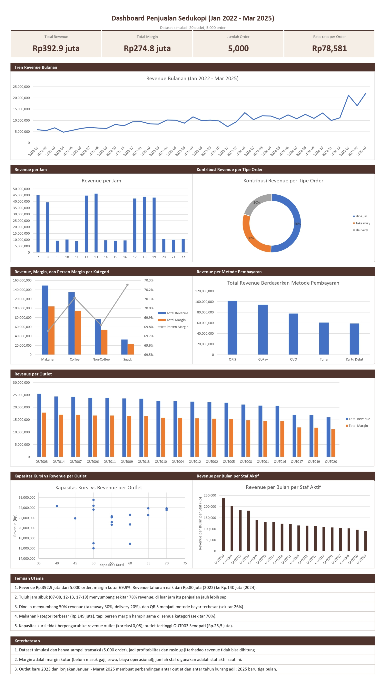

# Sedukopi: Analisis Penjualan Kedai Kopi dengan Excel

Proyek portofolio data analyst keempat. Setelah [Python](https://github.com/pajareeeee/gayanara_ecommerce_analysis), [SQL](https://github.com/pajareeeee/gayanara_sql_analysis), dan [Power BI](https://github.com/pajareeeee/sakumaya_powerbi_dashboard), kali ini analisisnya dikerjakan sepenuhnya di **Excel**: validasi data, penggabungan tabel, Pivot Table, dan dashboard satu halaman.

> Dataset simulasi "Sedukopi "Jaringan Kedai Kopi" dari [Ngulik Data](https://ngulikdata.com/datasets/sedukopi). Semua data bersifat fiktif.

## Pertanyaan Bisnis

1. Outlet mana yang revenue-nya tertinggi dan terendah?
2. Bagaimana tren revenue bulanan?
3. Kategori menu mana yang paling besar revenue dan margin-nya?
4. Jam berapa penjualan paling ramai?
5. Tipe order mana (dine in, takeaway, delivery) yang paling besar kontribusinya?
6. Metode pembayaran apa yang menghasilkan pendapatan tertinggi dan terendah?
7. Apakah outlet dengan kursi lebih banyak revenue-nya lebih besar?
8. Bagaimana rasio gaji staf terhadap revenue per outlet?

## Isi Workbook

File: `sedukopi_analisis.xlsx`

| Sheet | Fungsi |
|---|---|
| `Dashboard` | Ringkasan satu halaman: 4 angka utama, 8 grafik, temuan, dan keterbatasan |
| `Catatan` | Tiap pertanyaan bisnis beserta jawaban, catatan, dan rekomendasi |
| `analisis`, `tren`, `kategori`, `jam`, `tipe order`, `metode pembayaran` | Pivot Table dan PivotChart untuk pertanyaan 1-6 |
| `kapasitas`, `staff` | Tabel rumus untuk pertanyaan 7 dan 8 (data dari tabel outlets dan staff) |
| `validasi` | Pengecekan kualitas data dengan rumus |
| `data` | Tabel gabungan satu baris per item terjual, lengkap dengan tanggal, outlet, kategori, harga pokok, margin |
| `raw_*` | Lima tabel asli (orders, details, menu, outlets, staff), tidak diubah |

## Keputusan Data

- Data mentah tidak diubah, tiap CSV diimpor ke sheet `raw_*` dan dijadikan Excel Table
- Validasi dengan rumus: jumlah baris cocok (5.000 order, 8.123 detail), tidak ada `order_id` ganda, tidak ada total kosong, dan total order sama dengan jumlah detail (selisih 0)
- Sheet `data` dibuat dari tabel detail dengan `XLOOKUP` untuk mengambil tanggal, outlet, kategori, harga pokok, tipe order, dan metode bayar, plus kolom hitung biaya, margin, bulan, dan jam
- Revenue = `subtotal` item. Margin = `subtotal` - (`quantity` x `cost_price`), jadi margin kotor
- Analisis staf memakai staf berstatus aktif, karena data hanya mencatat status terakhir

## Temuan Utama

- Revenue Rp392,9 juta dari 5.000 order, margin kotor 69,9%, rata-rata Rp78.581 per order
- Revenue tahunan naik dari Rp80 juta (2022) ke Rp140 juta (2024). Bulan tertinggi Mar 2025 (Rp22,1 juta), terendah Apr 2022 (Rp4,8 juta)
- Tujuh jam sibuk (07-08, 12-13, 17-19) menyumbang sekitar 78% revenue. Jam 13 tertinggi, jam 11 paling sepi
- Dine in 50% revenue, takeaway 30%, delivery 20%
- QRIS metode bayar terbesar (25,8%), disusul GoPay (24,0%) dan OVO (19,7%)
- Makanan kategori terbesar (Rp149 juta), tapi persen margin hampir sama di semua kategori (sekitar 70%)
- Outlet tertinggi OUT003 Senopati (Rp25,5 juta), terendah OUT020 Margonda (Rp16,0 juta)
- Kapasitas kursi tidak berhubungan dengan revenue (korelasi 0,08)

## Insight dan Rekomendasi

- **Pertumbuhan sebagian karena outlet bertambah.** Outlet aktif naik dari 12 (awal 2022) ke 18 (Juni 2023), jadi revenue yang naik belum tentu berarti tiap outlet makin laris. Lonjakan Jan-Mar 2025 datang dari jumlah order (sekitar 146 menjadi 246 per bulan), bukan nilai per order. Ini perlu dicek dan mungkin hanya pola dataset simulasi.
- **Jam sibuk menentukan penjadwalan.** Jadwal staf bisa difokuskan ke tiga puncak (pagi, makan siang, sore). Promo di jam sepi layak dicoba, tapi data ini belum bisa menjawab apakah promo akan efektif, jadi perlu diuji dulu.
- **Dine in separuh revenue.** Pengalaman di outlet paling penting. Delivery 20% masih bisa dikembangkan, tapi data belum memuat biaya pengiriman atau komisi platform.
- **Untung ditentukan volume, bukan harga pokok.** Persen margin tiap kategori hampir sama, jadi menaikkan penjualan Makanan dan Coffee lebih berpengaruh daripada mengubah harga pokok.
- **Menambah kursi belum tentu menaikkan penjualan.** Outlet 50 kursi (OUT003, OUT014) justru di atas outlet 70 kursi (OUT006, OUT013).
- **Revenue per staf layak ditinjau.** OUT008 dan OUT010 punya 6 staf tapi revenue per staf rendah, sementara OUT016 dan OUT009 tertinggi dengan 3 staf. Revenue per staf yang tinggi bisa berarti efisien atau justru kekurangan orang, data ini belum bisa membedakannya.

## Keterbatasan

- Dataset simulasi dan hanya sampel transaksi (5.000 order). Gaji bulanan staf per outlet sekitar 13-44 kali lipat revenue bulanannya, jadi rasio gaji terhadap revenue dan profitabilitas tidak bisa dihitung secara bermakna.
- Margin adalah margin kotor (belum termasuk gaji, sewa, dan biaya operasional)
- Outlet yang buka 2023 (OUT017, OUT019, OUT020) punya periode jualan lebih pendek, jadi perbandingan total antar outlet kurang adil. OUT015 dan OUT018 tidak punya order (status temporarily closed)
- 2025 baru tiga bulan (Jan-Mar), jangan dibandingkan dengan total tahun lain

## Cara Membuka

1. Unduh `sedukopi_analisis.xlsx`
2. Buka dengan Microsoft Excel (rumus `XLOOKUP` tidak jalan di versi lama)
3. Mulai dari sheet `Dashboard`, lalu `Catatan` untuk jawaban lengkap tiap pertanyaan

## Skill yang Dipakai

Pivot Table dan PivotChart, Excel Table dan structured reference, `XLOOKUP`, `SUMIFS`, `COUNTIFS`, `DATEDIF`, `CORREL`, Calculated Field, validasi data dengan rumus, desain dashboard, dan penulisan temuan serta keterbatasan analisis.